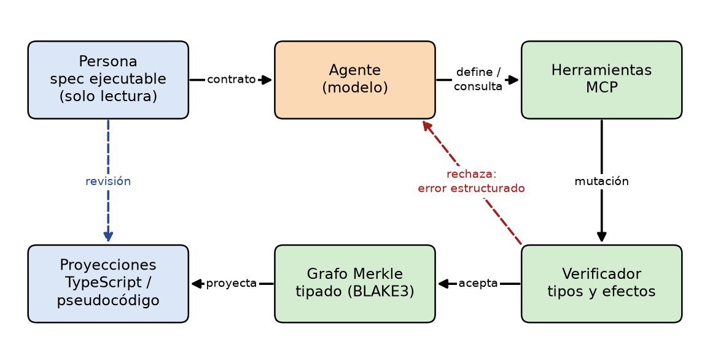
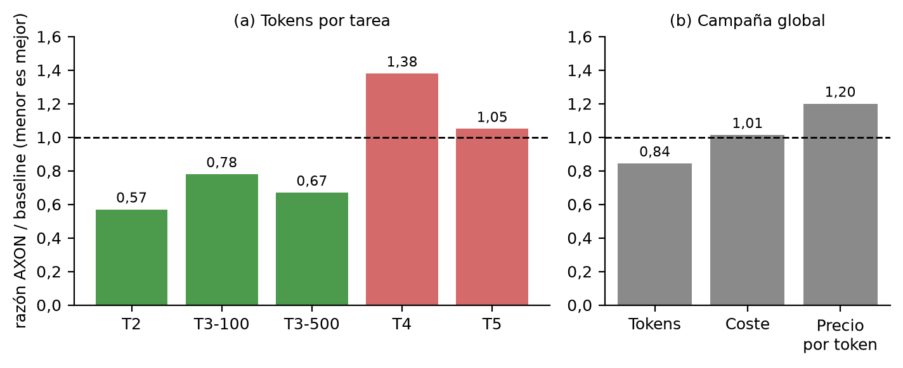

# AXON Docs

[English](README.md) · **Español**

Papers y documentación de **AXON**, un sustrato experimental en el que agentes de IA construyen software mutando un grafo Merkle tipado y direccionado por contenido, bajo una especificación ejecutable escrita por una persona, con proyecciones legibles (pseudocódigo / TypeScript) para la supervisión humana.

## Papers

### Hacia una interfaz nativa para agentes: grafos inmutables verificables, coste de inferencia por tarea verificada y la paradoja generativa

*José Luis Regalado · noviembre de 2026*

| Idioma | Leer en línea | PDF | Fuente LaTeX |
|---|---|---|---|
| English | [Markdown](papers/inference-cost/axon-paper.en.md) | [PDF](papers/inference-cost/axon-paper.en.pdf) | [.tex](papers/inference-cost/axon-paper.en.tex) |
| Español | [Markdown](papers/inference-cost/axon-paper.es.md) | [PDF](papers/inference-cost/axon-paper.es.pdf) | [.tex](papers/inference-cost/axon-paper.es.tex) |



**Resumen.** Cuando el autor operativo del software es un agente, usar archivos de código pensados para personas como interfaz de construcción puede encarecer la inferencia. AXON permite que el agente trabaje sobre un grafo verificable, contrastado con una spec ejecutable que el agente no puede modificar. El paper propone el **coste de inferencia por tarea verificada** como métrica de decisión y reporta una campaña preregistrada de 50 corridas frente a un baseline TypeScript:

- Misma tasa de éxito: 25/25 en ambos brazos, en casos visibles y ocultos.
- 15,6 % menos de tokens (hasta 43 % en un cambio amplio), pero coste monetario neutro (+1,4 %, intervalo compatible con ganancia o pérdida), porque el precio efectivo por token fue mayor.
- Un modelo multiplicativo de coste identifica dónde está el margen y argumenta que el **ajuste fino** de un modelo sobre la interfaz puede mejorar las palancas relevantes: el prefijo fijo de instrucciones, las iteraciones de reparación, la tasa de éxito y el tamaño del modelo.
- Se proponen hipótesis falsables (H1–H4) y un diseño experimental 2×2. **Todavía no se reportan mediciones con ajuste fino.**
- Se discute la paradoja generativa (Trifonov y Levit, 2026) como restricción de diseño para preservar la capacidad humana.



## Estructura del repositorio

```
papers/
  inference-cost/
    axon-paper.{en,es}.{md,tex,pdf}   paper en cada idioma
    figs/{en,es}/                      figuras (PDF para LaTeX, PNG para Markdown)
    figs/make_figs.py                  regenera las figuras
    README.md                          instrucciones de compilación
```

Para compilar los PDF o regenerar las figuras, véase [`papers/inference-cost/README.md`](papers/inference-cost/README.md).
