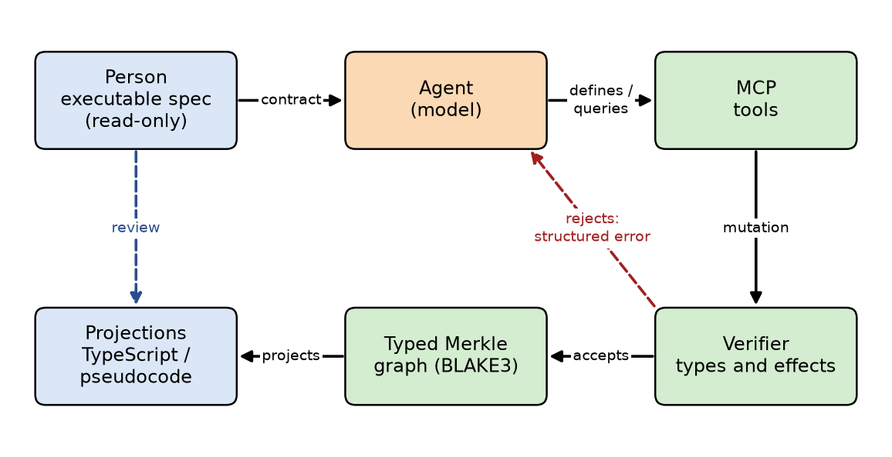
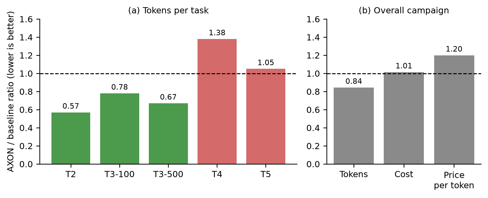

# AXON Docs

**English** · [Español](README.es.md)

Research papers and documentation for **AXON**, an experimental substrate in which AI agents build software by mutating a typed, content-addressed (Merkle) graph under a human-written executable specification, with readable projections (pseudocode / TypeScript) for human oversight.

## Papers

### Toward an Agent-Native Interface: Verifiable Immutable Graphs, Inference Cost per Verified Task, and the Generative Paradox

*José Luis Regalado · November 2026*

| Language | Read online | PDF | LaTeX source |
|---|---|---|---|
| English | [Markdown](papers/inference-cost/axon-paper.en.md) | [PDF](papers/inference-cost/axon-paper.en.pdf) | [.tex](papers/inference-cost/axon-paper.en.tex) |
| Español | [Markdown](papers/inference-cost/axon-paper.es.md) | [PDF](papers/inference-cost/axon-paper.es.pdf) | [.tex](papers/inference-cost/axon-paper.es.tex) |



**Summary.** When the operational author of software is an agent, using source files designed for humans as the construction interface can make inference more expensive. AXON lets the agent work on a verifiable graph instead, checked against an executable spec the agent cannot modify. The paper proposes the **inference cost per verified task** as the decision metric, and reports a preregistered 50-run campaign against a TypeScript baseline:

- Same success rate: 25/25 in both arms, on visible and hidden cases.
- 15.6% fewer tokens (up to 43% on a broad change), but a neutral monetary cost (+1.4%, interval compatible with a gain or a loss), because the effective price per token was higher.
- A multiplicative cost model identifies where the margin lies and argues that **fine-tuning** a model on the interface can improve the levers that matter: the fixed instruction prefix, repair iterations, success rate, and model size.
- Falsifiable hypotheses (H1–H4) and a 2×2 experimental design are proposed. **No fine-tuning measurements are reported yet.**
- The generative paradox (Trifonov and Levit, 2026) is discussed as a design constraint for keeping human capability intact.



## Repository layout

```
papers/
  inference-cost/
    axon-paper.{en,es}.{md,tex,pdf}   paper in each language
    figs/{en,es}/                      figures (PDF for LaTeX, PNG for Markdown)
    figs/make_figs.py                  regenerates the figures
    README.md                          build instructions
```

To build the PDFs or regenerate the figures, see [`papers/inference-cost/README.md`](papers/inference-cost/README.md).
