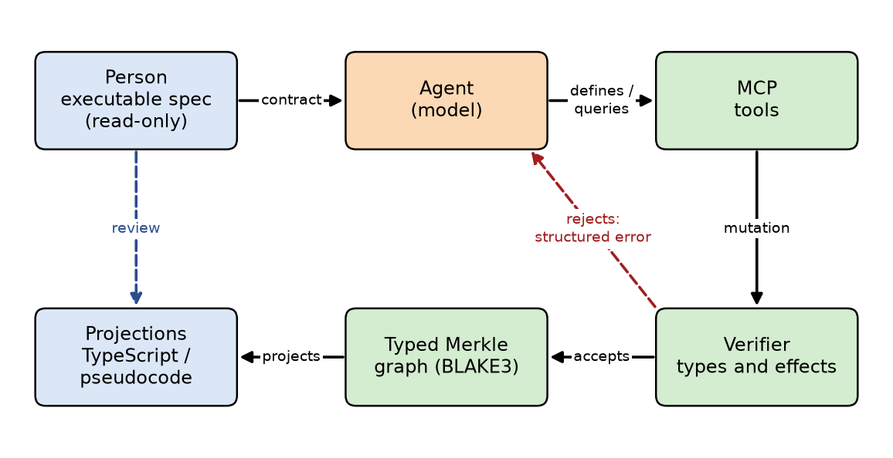
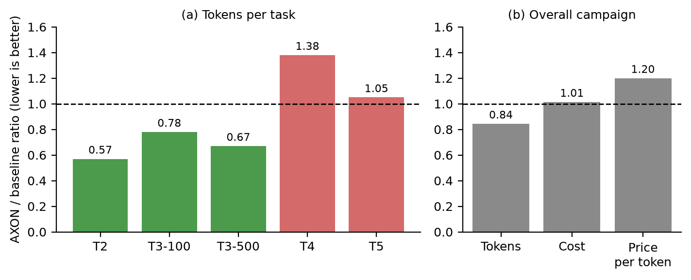
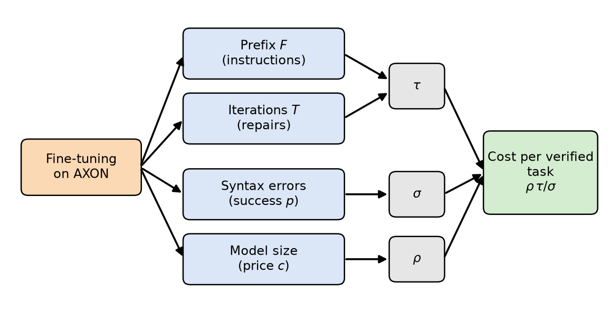
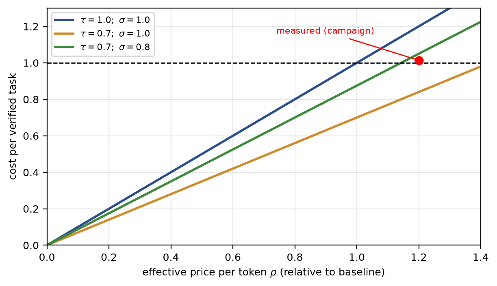
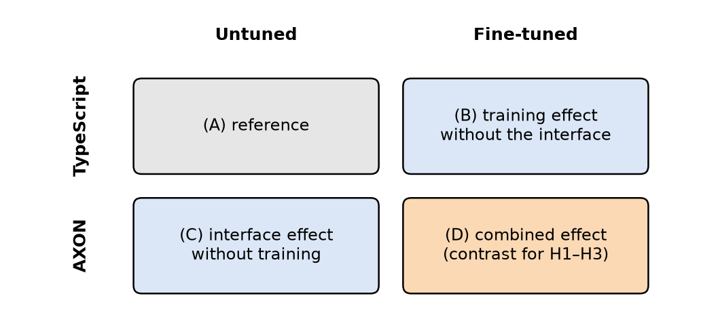

# Toward an Agent-Native Interface: Verifiable Immutable Graphs, Inference Cost per Verified Task, and the Generative Paradox

**José Luis Regalado** · djdaga@gmail.com · November 2026

> Markdown version of the paper (equivalent to `axon-paper.en.tex`). Versión en español: [`axon-paper.es.md`](axon-paper.es.md).

## Abstract

Source code serves two purposes at once: it is an instruction for the machine and a medium of communication between people. When the operational author is an agent, that duality can make inference more expensive. We present AXON, an experimental substrate in which the agent builds programs by mutating a typed Merkle graph, under an executable specification that the agent cannot modify, with human-readable projections for oversight. We propose the *inference cost per correct, verified task* as the decision metric, rather than the volume of text processed. In a preregistered campaign of 50 runs (tasks T2–T5, same model in both arms), AXON matched the baseline success rate (25/25 in both arms, on visible and hidden cases), with 15.6% fewer tokens and a neutral monetary cost (+1.4%, with an interval compatible with either a gain or a loss). This neutrality is not a dead end: the cost decomposition shows where the margin lies and why it is reachable. We argue that this margin comes from components that *fine-tuning* the model on the interface can directly improve: the fixed instruction prefix, the repair iterations, and the need for a larger model. We formalize this hypothesis with a multiplicative cost model, state falsifiable predictions, and propose an experimental design to test it. We do not yet present measurements with fine-tuning; we contribute a working substrate, a baseline measurement with equivalent success, an identified mechanism, and a protocol ready to be run. We also discuss the *generative paradox* (Trifonov and Levit, 2026) as a design opportunity: the same interface that makes inference cheaper can return more capacity to govern the system to the person, not less, so reducing costs and improving the human experience are mutually reinforcing goals.

## 1. Introduction

Modules, design patterns, and naming conventions are not requirements of the machine; they are tools for reducing the cognitive load that complex systems place on people [2]. Agents based on language models change this economy: they can traverse large codebases, but they do so through an interface designed for people (files, directory trees, diffs, repeated names), with costs inherent to that interface: context that is re-read, dependencies that are reconstructed, and constraints that are discovered only when tests are run.

This work makes three contributions:

1. It describes AXON [1], a construction substrate for agents (typed Merkle graph, immutable specification, human-readable projections) and delimits precisely what is implemented.
2. It reports, without omissions, the measurements of a preregistered campaign, and interprets them with a metric of inference cost per verified task.
3. It formulates a cost model and a falsifiable hypothesis (with four predictions, H1–H4, Section 6.3): that fine-tuning a model on this interface reduces the cost per verified task beyond what the interface achieves on its own. This third contribution is a *proposal*, not a result.

## 2. Theoretical Framework and Limits of the Sources

Cao [2] argues that, in a system of $n$ components, the space of possible interactions grows exponentially, while the human capacity to reason about it is essentially constant. The scope of the argument needs to be stated precisely: his Proposition 2.1 is written as $P(n)\in\Theta(2^n)$, but its justification counts the $2^{\binom{n}{2}}$ possible dependency graphs and presents the result as an *upper bound* ("real systems do not realize all configurations"). We therefore take it as qualitative motivation rather than as a result demonstrated for real systems.

Cao also cites the EvoClaw benchmark (Deng et al., 2026), where performance drops from more than 80% on isolated tasks to at most 38% under continuous software evolution. We use that figure as it appears in the source (">80% to ≤38%"); we do not restate it as a percentage drop because the source does not.

Trifonov and Levit [3] is a *position paper* written primarily for education. It distinguishes four manifestations of the generative paradox (performance, assistance, ownership, and capability stock) and puts forward falsifiable predictions, not results in software engineering. We use it as design guidance (Section 7), not as evidence about coding agents.

## 3. AXON: Verifiable Representation and Decoupled Interfaces

### 3.1 Merkle Graph and Executable Specification

The unit of construction is an immutable node identified by the BLAKE3 hash of a canonical binary encoding; children are referenced by identifier, so the identity of an expression incorporates its structure. A change creates new nodes, and earlier versions remain. Names and roots are controlled mutable pointers.

This does not prevent the agent from proposing a wrong solution; it prevents a mutation from silently changing the identity of what is already stored, and it rejects, before they are activated, definitions that violate shape, types, or effects.

A person provides a read-only executable *spec*: nominal types, storage, capabilities, effect bounds, and acceptance cases (visible and hidden). The verifier checks every definition at the write boundary and derives transitive effects; a redefinition that exceeds the granted authority is rejected even if its tests return the expected value. Each invocation runs inside a transaction that rolls back both the KV store and SQL on error. An incomplete spec cannot detect properties it never declared.

### 3.2 Agent Interface and Human Projections

Figure 1 summarizes the flow.

The agent operates through MCP tools (`define_many`, `query_graph`, `run_spec`, atomic replacement of dependents). The current implementation uses a compact textual syntax as the transport: it is translated into a canonical graph and is not the persistent source code, but neither does it remove text from the interface. For people, the graph is projected as pseudocode and, for the supported subset, exported as a standalone TypeScript module. That output is a view for inspection, auditing, and migration, not what the agent builds.

*Figure 1. AXON data flow. Blue: elements under human control; orange: the model; green: the deterministic substrate. The agent modifies the graph only through the verifier; whatever is rejected returns as a structured error.*

## 4. Metric: Inference Cost per Verified Task

A smaller volume of processed text is not an end in itself: it may be irrelevant to monetary cost (cached input, uncached input, and output are priced differently) or may come with a lower success rate. We adopt as our metric the expected inference cost of obtaining a deliverable that satisfies the spec:

$$
\bar{C} = \frac{\mathbb{E}[C_{\text{run}}]}{p},
\qquad
C_{\text{run}} = c_{\text{in}} N_{\text{in}} + c_{\text{cache}} N_{\text{cache}} + c_{\text{out}} N_{\text{out}} \tag{1}
$$

where $p$ is the probability that a run passes both the visible and the hidden cases, $N_{\text{in}}, N_{\text{cache}}, N_{\text{out}}$ are the uncached input, cached input, and output tokens, and $c_\bullet$ are their unit prices. If retries are independent, $1/p$ is the expected number of runs per verified deliverable. Latency, number of tool calls, and human review effort, which (1) does not capture, should also be reported.

We further decompose the cost of a run into a fixed prefix $F$ (tool descriptions and instructions, repeated on every turn), $T$ iterations, and a variable context $H_t$ per iteration:

$$
N_{\text{in}} + N_{\text{cache}} = \sum_{t=1}^{T} (F + H_t) \tag{2}
$$

**Spec determinism and the scope of $p$.** The spec is deterministic; the agent is not. This brings one advantage and three caveats. The advantage is that verification is cheap, repeatable, and requires no human judgment: every run is classified unambiguously, which makes $p$ measurable and allows trajectories to be filtered automatically for fine-tuning (Section 6). The caveats are: (i) *verified* means that the run satisfies the spec, not that it is correct; an incomplete spec makes $p$ overestimate actual quality, which is why hidden cases matter; (ii) a model trained against a verifier may learn to pass the visible cases without generalizing, so evaluation must use hidden cases and held-out task families; (iii) the assumption of independent retries in (1) is weak, because with the same model and the same task a failure tends to repeat, so $\mathbb{E}[C]/p$ may underestimate the cost; it is advisable to estimate it from the empirical per-task cost distribution.

In addition, (1) omits two costs that do belong to the deliverable: the verifier's compute $c_v$ (small, but measurable) and the human effort of writing and reviewing the spec, $c_h$, amortized per deliverable. The total cost is $\bar{C}_{\text{tot}} = \bar{C} + c_v + c_h$. The requirements-discovery layer that we are developing in parallel (stories approved by the person and deterministically compiled into a spec) aims precisely at reducing $c_h$.

## 5. Experimental Evidence

### 5.1 Tasks and Arms

Tasks T2–T5 belong to the project's benchmark (T1 is an informative calibration task and is not part of the decisive results). Each task is evaluated in two *arms*: *AXON* (the agent builds on the graph) and the *baseline* (the same agent modifies a strict TypeScript repository with tests), with the same requirements statement. A *run* is one complete attempt by an agent; it succeeds only if it passes the visible and the hidden cases of all its steps. Table 1 describes each task; in T3, the suffix (100 or 500) is the size of the base project in functions, that is, in defined names.

To make this concrete, consider T2, the task written from scratch. The agent is asked to build a small accounting application: accounts with an owner and a balance, and money movements between them. There are four operations: open an account, query its balance, transfer money, and list an account's movements. The difficulty lies not in the volume of code but in the exactness of the rules. For example, a transfer checks six conditions in a fixed order (a positive amount, different accounts, the origin exists, the destination exists, the movement id has not been used before, and the origin has enough balance); the first failure determines the result and nothing is written. If all goes well, the sum of all balances remains unchanged, and a sum that would overflow the 64-bit integer aborts without leaving any change. It is a bounded task that nevertheless demands precision, and it measures the cost of writing a new program from beginning to end.

**Table 1.** Tasks of the main campaign.

| Task | What is asked | What it measures |
|---|---|---|
| T2 | Build from scratch a ledger of transfers between accounts: account creation, balance lookup, a transfer with six ordered validations and an overflow-checked sum, and a listing of movements. | Writing a new program |
| T3-100, T3-500 | A chain of three requirement changes on an existing orders-and-inventory project: (1) change the tax computation and rounding in a shared helper, (2) extend the customer record while preserving existing data, (3) add a per-customer summary that reuses helpers. The project has ≈100 or ≈500 functions, with the same core and more periphery. | Incremental evolution and effect of project size |
| T4 | Fix a project of ≈100 functions whose spec has failing cases; the cause lies in a shared helper and the spec cannot be modified. | Localized fix |
| T5 | A cross-cutting change: tax now depends on the product category and a root is renamed, together with all of its dependents. | Refactor with many dependents |

### 5.2 Main Campaign

Phase 2 compared AXON with a TypeScript baseline using the same model (Codex). The preregistered protocol ran 50 decisive runs on tasks T2–T5 (Table 1): five runs per arm and task, per-cell medians, and 90% bootstrap intervals. Both arms achieved 25/25 successes, on both visible and hidden cases, so there is no observable difference in $p$.

- Total tokens: −15.6% with AXON (90% CI: 3.6% to 22.8% reduction).
- Monetary cost: +1.4%, with an interval compatible with either a gain or a loss.

With a token ratio of ≈ 0.84 and a cost ratio of ≈ 1.01, the effective price per token for AXON was approximately 1.2 times that of the baseline (a figure derived from the aggregates, without an interval). The recorded cause is the tool-description prefix and a worse proportion of cached input. Figure 2 shows it: the measured token savings did *not* translate into cost savings. This is the main empirical conclusion and it conditions the rest of the paper.

**Table 2.** AXON/baseline token ratio per task (per-cell medians, $n=5$ per arm).

| Task | Ratio | Reading |
|---|---:|---|
| T2 | 0.57 | clear advantage on a broad change |
| T3-100 | 0.78 | advantage on incremental evolution |
| T3-500 | 0.67 | larger advantage as the project grows |
| T4 | 1.38 | disadvantage on a localized fix |
| T5 | 1.05 | practically a tie, with a higher fixed cost |

*Figure 2. AXON/baseline ratio (dashed line = 1; lower is better). (a) Green: AXON uses fewer tokens; red: more. (b) The token savings (0.84) do not translate into cost savings (1.01) because the effective price per token is higher (1.20, derived from the aggregates, without an interval).*

### 5.3 Model Dependence

In exploratory rounds, Codex and Claude Sonnet found advantages on some large tasks, while DeepSeek Flash spent between 1.5 and 4.4 times more tokens with the syntax available at the time. The affinity between model and interface is part of the measured system. This dependence is precisely the one that fine-tuning would aim to reduce.

### 5.4 Preliminary Observation with a Small Model

As a feasibility probe, a local model of roughly 2 billion parameters, without fine-tuning, solved none of ten runs of a minimal task (0/10 across three prompt variants): it invented helper functions, left parentheses unclosed, and truncated its output. This is a baseline observation, not an experiment; it shows room for improvement, but also that a small model does not use the interface without adaptation.

### 5.5 Threats to Validity

Samples of 3–5 runs per cell; a baseline without an equivalent graph tool in the main campaign; some language improvements evaluated after the protocol freeze (and therefore outside the preregistration); a single provider in the decisive campaign; tasks designed by the authors of the substrate. Independent replication is needed, with new tasks, more models, and human teams.

## 6. Fine-Tuning as the Main Lever for Inference Savings

### 6.1 Why Fine-Tuning Acts on the Components of Cost

On its own, the AXON interface reduced the volume of context on broad changes, but it imposes a fixed cost that the base model must pay on every turn. A model fine-tuned on the interface can change four factors of the cost (1)–(2):

1. **Prefix $F$.** If the correct use of the tools and the syntax is internalized in the weights, the instructions and examples can be shortened or removed from the prompt, and the remaining prefix is stable and cacheable.
2. **Iterations $T$.** A model trained on structured verifier errors and their correct repairs should converge in fewer repair rounds.
3. **Success $p$.** Reducing syntactically invalid outputs (such as those in the previous section) raises $p$ and thereby lowers the factor $1/p$.
4. **Price per token $c_\bullet$.** If the deterministic verifier takes over part of the burden of remembering constraints, a smaller and cheaper model could reach the same $p$.

*Figure 3. Levers of fine-tuning on cost. Fine-tuning acts on four factors that group into the token ratio $\tau$, the success ratio $\sigma$, and the price ratio $\rho$. This is a diagram of the hypothesis, not a result.*

### 6.2 Multiplicative Model

Let $\tau$ be the per-run token ratio, $\rho$ the ratio of effective price per token, and $\sigma = p_{\text{ft}}/p_{\text{base}}$ the success ratio, of the fine-tuned system relative to a reference model. Then

$$
\frac{\bar{C}_{\text{ft}}}{\bar{C}_{\text{base}}} = \frac{\rho\,\tau}{\sigma} \tag{3}
$$

Fine-tuning acts on all three factors at once, and their effects compound. Figure 3 outlines the levers, and Figure 4 and Table 3 show the sensitivity of (3). The values are *illustrative scenarios* computed arithmetically from (3); they are not measurements.

**Table 3.** Cost ratio per verified task according to (3). Illustrative scenarios, not measured.

| Effective price $\rho$ | $\tau=1.0;\ \sigma=1$ | $\tau=0.7;\ \sigma=1$ | $\tau=0.7;\ \sigma=0.8$ |
|---|---:|---:|---:|
| 1.0 | 1.00 | 0.70 | 0.88 |
| 0.5 | 0.50 | 0.35 | 0.44 |
| 0.2 | 0.20 | 0.14 | 0.18 |

The relevant reading is twofold. First, with the current interface the measured point is $\rho \approx 1.2$ and $\tau \approx 0.84$, that is, a ratio of ≈ 1.01: the savings are limited by $\rho$. Second, a reduction in $\rho$ (a smaller model or better caching, possible only if the model reaches the same $\sigma$) has a larger effect than any plausible improvement in $\tau$. The value of fine-tuning lies in making that shift in $\rho$ feasible without losing $\sigma$.

*Figure 4. Sensitivity of the cost ratio $\rho\tau/\sigma$. The dashed line marks break-even with the baseline. The lines are illustrative scenarios; the red dot is the campaign measurement. Reducing $\rho$ without losing $\sigma$ moves the system below break-even.*

### 6.3 Hypotheses

- **H1.** A model fine-tuned on AXON reduces $F$ (instruction-prefix tokens) without reducing $p$.
- **H2.** The fine-tuned model needs fewer repair iterations $T$ than the same model without fine-tuning on held-out tasks.
- **H3.** A small model fine-tuned on AXON matches the $p$ of a larger untuned model working on conventional TypeScript, at a lower cost $\bar{C}$.
- **H4.** The effect holds on tasks and domains not seen in training (generalization).

### 6.4 Proposed Experimental Design

- **2×2 design** (Figure 5) with the same base model: {untuned, fine-tuned} × {TypeScript, AXON}. Fine-tuning must also be measured on TypeScript to separate the effect of the interface from the effect of the additional training.
- **Training data:** trajectories attempt → structured error → repair → spec satisfied, filtered by the verifier (only those that pass are kept). Filtering is automatic because the spec is executable.
- **Hold-out:** evaluation tasks, and their generating families, are excluded from training; decontamination is declared.
- **Metrics:** $\bar{C}$ with explicit list prices, $p$ (hidden cases), tokens broken down by type, latency, repairs, tool calls; bootstrap intervals, with tasks and threshold preregistered.
- **Model ladder:** first a small open model (which allows local execution and full control of the weights); then a general-purpose model fine-tuned by a provider, where possible.

*Figure 5. 2×2 design with the same base model. Comparing (D) with (C) and (B) separates the contribution of fine-tuning from that of the interface.*

## 7. The Generative Paradox as a Design Opportunity

For anyone running models at scale, the primary goal is to reduce inference cost; what is valuable about this approach is that this goal and the benefit to the person advance together. An interface that makes inference cheaper through an executable specification, a traceable history, and readable projections delivers, downstream, a product that the person can understand, review, and correct with less effort. It is a win–win: the provider spends less compute per deliverable and the person governs what they receive more effectively.

Trifonov and Levit [3] provide the framework for thinking about that second half. They argue that a human–AI collaboration can improve the joint product without the human retaining the capacity to understand, challenge, and repair it once the assistance changes or disappears, and they distinguish four manifestations: *performance* (the product improves, individual capability does not), *assistance* (less friction removes opportunities for generation, justification, or monitoring), *ownership* (formal authorship and consequential control diverge), and *capability stock* (locally efficient delegation narrows the future distribution of expertise). It is a position paper with falsifiable predictions, written for education; its application to coding agents is our own extrapolation, not a result of theirs.

Seen as an opportunity, AXON provides the means for fine-tuning and improvement of the human experience to go hand in hand. The design implications, which we treat as lines of work rather than proven facts, are:

- the spec, the authority bounds, the history, and the readable projections remain in the person's hands, and fine-tuning on the interface does not degrade them but reduces the cost of maintaining them;
- requirements-definition phases can elicit the person's assumptions and edge cases before generating the solution, following the canonical *Anti-Prompt* sequence [3], so that the person approves in plain language what will be built;
- measuring such a system can include retained human capability alongside cost per task, turning it into another outcome to improve.

## 8. Economic Viability

**The central argument is the reduction of inference cost.** For a model provider, what matters is how much it costs to deliver a correct, verified task. The executable spec provides an observable acceptance condition, which makes it possible to measure that cost per deliverable and, from there, tie prices to completed tasks rather than generated text, with model selection and compute budget managed by the provider. A small fine-tuned model that satisfies H3 would reduce compute per deliverable, allow serving more tasks with the same infrastructure, open up work that is uneconomical today (continuous maintenance, routine migrations), or improve margin. All of this depends on H1–H4 being confirmed; until then, it is a projection. Nor does it shift responsibility to the verifier or guarantee that a spec is complete.

**How the argument has been refined.** The course of this work shows increasing precision, and each step has left the remaining gap smaller and better identified:

1. We started from token savings (−15.6% in the campaign, down to 0.57 on T2).
2. The measurement showed that tokens are not cost: monetary cost was neutral (+1.4%).
3. We therefore changed the metric to inference cost per verified task and decomposed it into a multiplicative model ($\rho\tau/\sigma$).
4. The decomposition located the gap: it is not the number of tokens but their effective price (the tool prefix and the share of cached input), a factor on which fine-tuning and protocol design can act directly.

Each clarification has brought the proposal closer to what can be measured, and the remaining levers are concrete.

**The effect of scale: 1% is enough.** If a system reduces the cost per verified deliverable by a fraction $s$ without changing $p$, the absolute savings over $N$ deliverables are $s\,N\,\bar{C}_{\text{base}}$. With $s = 1\%$ and $N = 10^{6}$ deliverables, this equals the entire cost of $10^{4}$ tasks, and it grows linearly with volume. For anyone running millions of development tasks, an inference saving of just 1% already justifies the proposal, and anything above that threshold is a gain. That is the most pessimistic scenario we consider, and there are several ways to reach it that do not depend on a single lever: further language and protocol optimizations (a shorter fixed prefix, better cache utilization, more informative error messages), prompt improvements and, if the provider decides to do so, some fine-tuning of the model on the interface. The condition is that this margin be *real*: its confidence interval must exclude zero and $p$ must not decrease. The current campaign does not yet demonstrate this (cost +1.4%, indistinguishable from zero), but it shows that the token margin exists on broad changes and that the remaining gap is one of effective price.

**Win–win.** Reducing inference cost and improving the person's experience do not compete: the same executable spec that makes it possible to measure and reduce the cost of the deliverable gives the person a clear acceptance criterion, and the readable projections used to supervise the system allow them to understand and correct what they receive. The provider gains margin; the person gains control.

## 9. Conclusion

AXON is a substrate that works end to end and that matched the success rate of a conventional baseline, with a 15.6% reduction in tokens (up to 43% on a broad change) and a neutral monetary cost in the current campaign. The appropriate metric is the inference cost per verified task, and the cost decomposition identifies the levers with the most potential: the instruction prefix, the repair iterations, success, and model size. These are precisely the ones that fine-tuning on the interface can improve, and at the scale of millions of deliverables a saving of just 1% is enough to make the proposal profitable. This trajectory is supported by a cost model, hypotheses, and an experimental design, but confirming it is the next step. And it is a win–win: lower inference cost for those operating the models, and a product that is easier for the person to understand and govern.

**Availability.** The source code, the decision documents, and the full corpus are not part of this publication and should accompany a future release to allow independent replication.

## References

1. AXON Project Team (2026). *AXON: a verifiable representation for agent-driven software development* (original title in Spanish: *AXON: una representación verificable para el desarrollo de software por agentes*). Internal research document.
2. Cao, Z. (2026). *The End of Software Engineering: How AI Agents Are Fundamentally Restructuring the Software Paradigm*. arXiv:2606.05608v1 [cs.SE].
3. Trifonov, M., and Levit, V. E. (2026). *The generative paradox: the Anti-Prompt paradigm for human capability*. Position paper. arXiv:2610.40151v1.
