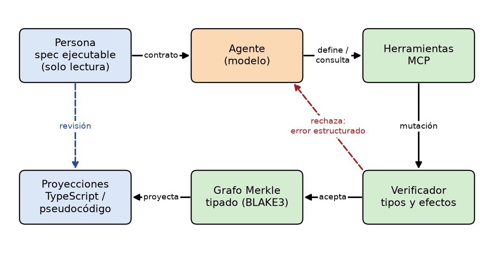
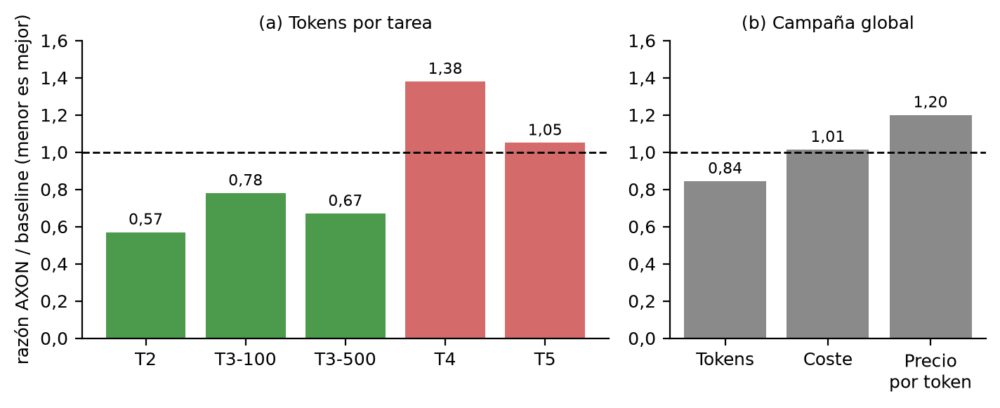
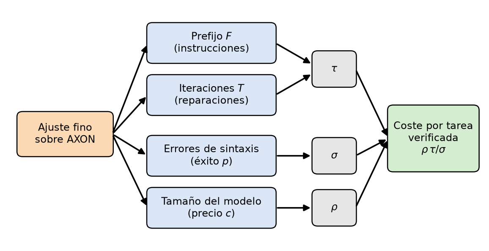
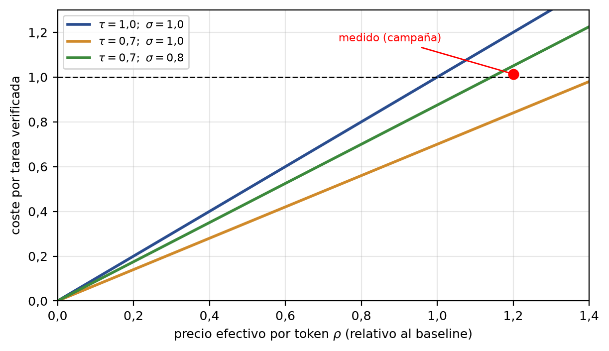
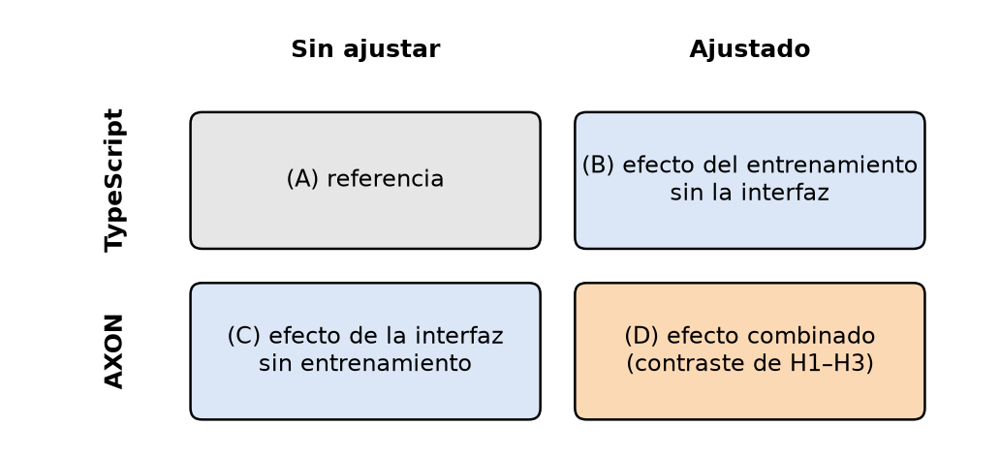

# Hacia una interfaz nativa para agentes: grafos inmutables verificables, coste de inferencia por tarea verificada y la paradoja generativa

**José Luis Regalado** · djdaga@gmail.com · Noviembre de 2026

> Versión en Markdown del paper (equivalente a `axon-paper.es.tex`). English version: [`axon-paper.en.md`](axon-paper.en.md).

## Resumen

El código fuente cumple a la vez dos funciones: instrucción para la máquina y medio de comunicación entre personas. Cuando el autor operativo es un agente, esa dualidad puede encarecer la inferencia. Presentamos AXON, un sustrato experimental en el que el agente construye programas mutando un grafo Merkle tipado, bajo una especificación ejecutable que el agente no puede modificar, con proyecciones legibles para la supervisión humana. Proponemos como métrica de decisión el *coste de inferencia por tarea correcta y verificada*, y no el volumen de texto procesado. En una campaña preregistrada de 50 corridas (tareas T2–T5, mismo modelo en ambos brazos), AXON igualó la tasa de éxito del baseline (25/25 en ambos brazos, visibles y ocultos), con un 15,6 % menos de tokens y un coste monetario neutro (+1,4 %, intervalo compatible con ganancia o pérdida). Esa neutralidad no es un callejón sin salida: la descomposición del coste muestra dónde está el margen y por qué es alcanzable. Argumentamos que ese margen proviene de componentes que un *ajuste fino* (fine-tuning) del modelo sobre la interfaz puede mejorar de forma directa: el prefijo fijo de instrucciones, las iteraciones de reparación y la necesidad de un modelo de mayor tamaño. Formalizamos esa hipótesis con un modelo multiplicativo de coste, enunciamos predicciones falsables y un diseño experimental para contrastarla. Aún no presentamos mediciones con ajuste fino; aportamos un sustrato funcional, una medición base con éxito equivalente, un mecanismo identificado y un protocolo listo para ejecutarse. Discutimos además la *paradoja generativa* (Trifonov y Levit, 2026) como oportunidad de diseño: la misma interfaz que abarata la inferencia puede devolver a la persona más capacidad de gobierno del sistema, no menos, de modo que reducir costes y mejorar la experiencia humana son objetivos que se refuerzan.

## 1. Introducción

Módulos, patrones de diseño y convenciones de nomenclatura no son requisitos de la máquina, sino herramientas para reducir la carga cognitiva humana ante sistemas complejos [2]. Los agentes basados en modelos de lenguaje alteran esa economía: pueden recorrer grandes bases de código, pero lo hacen a través de una interfaz concebida para personas (archivos, árboles de directorios, diffs, nombres repetidos), con costes propios de esa interfaz: contexto que se relee, dependencias que se reconstruyen y restricciones que se descubren solo al ejecutar pruebas.

Este trabajo hace tres contribuciones:

1. Describe AXON [1], un sustrato de construcción para agentes (grafo Merkle tipado, especificación inmutable, proyecciones legibles) y delimita con precisión lo que está implementado.
2. Reporta, sin recortes, la medición de una campaña preregistrada, y la interpreta con una métrica de coste de inferencia por tarea verificada.
3. Formula un modelo de coste y una hipótesis falsable (con cuatro predicciones, H1–H4, sección 6.3): que el ajuste fino de un modelo sobre esta interfaz reduce el coste por tarea verificada más allá de lo que logra la interfaz por sí sola. Esta tercera contribución es una *propuesta*, no un resultado.

## 2. Marco teórico y límites de las fuentes

Cao [2] argumenta que, en un sistema de $n$ componentes, el espacio de posibles interacciones crece de forma exponencial, mientras que la capacidad humana para razonar sobre él es esencialmente constante. Conviene precisar el alcance del argumento: su Proposición 2.1 se enuncia como $P(n)\in\Theta(2^n)$, pero su justificación cuenta los $2^{\binom{n}{2}}$ grafos de dependencia posibles y la presenta como una *cota superior* («los sistemas reales no realizan todas las configuraciones»). Lo tomamos, por tanto, como motivación cualitativa y no como un resultado demostrado sobre sistemas reales.

Cao cita además el benchmark EvoClaw (Deng et al., 2026), donde el rendimiento cae de más del 80 % en tareas aisladas a como máximo el 38 % en evolución continua del software. Usamos esa cifra tal como aparece en la fuente («>80 % a ≤38 %»); no la reexpresamos como un porcentaje de caída porque la fuente no lo hace.

Trifonov y Levit [3] es un *position paper* formulado principalmente para educación. Distingue cuatro manifestaciones de la paradoja generativa (rendimiento, asistencia, propiedad y stock de capacidades) y plantea predicciones falsables, no resultados en ingeniería de software. Lo empleamos como guía de diseño (sección 7), no como evidencia sobre agentes de programación.

## 3. AXON: representación verificable y desacoplamiento de interfaces

### 3.1 Grafo Merkle y especificación ejecutable

La unidad de construcción es un nodo inmutable identificado por el hash BLAKE3 de una codificación binaria canónica; los hijos se referencian por identificador, de modo que la identidad de una expresión incorpora su estructura. Un cambio crea nodos nuevos y las versiones anteriores permanecen. Los nombres y raíces son punteros mutables controlados.

Esto no impide que el agente proponga una solución errónea; impide que una mutación cambie en silencio la identidad de lo ya almacenado, y rechaza antes de activarlas las definiciones que violan forma, tipos o efectos.

Una persona proporciona una *spec* ejecutable de solo lectura: tipos nominales, almacenamiento, capacidades, cotas de efectos y casos de aceptación (visibles y ocultos). El verificador comprueba cada definición en la frontera de escritura y deriva los efectos transitivos; una redefinición que excede la autoridad concedida se rechaza aunque sus pruebas devuelvan el valor esperado. Cada invocación se ejecuta en una transacción que revierte KV y SQL ante un error. Una spec incompleta no detecta propiedades que nunca declaró.

### 3.2 Interfaz del agente y proyecciones humanas

La figura 1 resume el flujo.

El agente opera mediante herramientas MCP (`define_many`, `query_graph`, `run_spec`, reemplazo atómico de dependientes). La implementación actual usa una sintaxis textual compacta como transporte: se traduce a un grafo canónico y no es el código fuente persistente, pero tampoco elimina el texto de la interfaz. Para las personas, el grafo se proyecta como pseudocódigo y, en el subconjunto soportado, se exporta como un módulo TypeScript autónomo. Esa salida es una vista de inspección, auditoría y migración, no lo que el agente construye.

*Figura 1. Flujo de AXON. Azul: elementos bajo control humano; naranja: el modelo; verde: sustrato determinista. El agente solo modifica el grafo a través del verificador; lo rechazado vuelve como error estructurado.*

## 4. Métrica: coste de inferencia por tarea verificada

Un menor volumen de texto procesado no es un objetivo en sí mismo: puede ser irrelevante para el coste monetario (precios distintos para entrada cacheada, no cacheada y salida) o ir acompañado de una menor tasa de éxito. Adoptamos como métrica el valor esperado del coste de inferencia hasta obtener una entrega que satisface la spec:

$$
\bar{C} = \frac{\mathbb{E}[C_{\text{corrida}}]}{p},
\qquad
C_{\text{corrida}} = c_{\text{in}} N_{\text{in}} + c_{\text{cache}} N_{\text{cache}} + c_{\text{out}} N_{\text{out}} \tag{1}
$$

donde $p$ es la probabilidad de que una corrida pase los casos visibles y ocultos, $N_{\text{in}}, N_{\text{cache}}, N_{\text{out}}$ son los tokens de entrada no cacheados, de entrada cacheados y de salida, y $c_\bullet$ sus precios unitarios. Si los reintentos son independientes, $1/p$ es el número esperado de corridas por entrega verificada. Deben reportarse también latencia, número de llamadas a herramientas y trabajo humano de revisión, que (1) no captura.

Descomponemos, además, el coste de una corrida en un prefijo fijo $F$ (descripción de herramientas e instrucciones, repetido en cada turno), $T$ iteraciones y un contexto variable $H_t$ por iteración:

$$
N_{\text{in}} + N_{\text{cache}} = \sum_{t=1}^{T} (F + H_t) \tag{2}
$$

**Determinismo de la spec y alcance de $p$.** La spec es determinista, el agente no. Esto tiene una ventaja y tres precauciones. La ventaja es que verificar es barato, repetible y no requiere juicio humano: cada corrida se clasifica sin ambigüedad, lo que hace medible a $p$ y permite filtrar automáticamente trayectorias para el ajuste fino (sección 6). Las precauciones son: (i) *verificada* significa que satisface la spec, no que sea correcta; una spec incompleta hace que $p$ sobreestime la calidad real, de ahí el papel de los casos ocultos; (ii) un modelo entrenado contra un verificador puede aprender a pasar los casos visibles sin generalizar, por lo que la evaluación debe usar casos ocultos y familias de tareas retenidas; (iii) el supuesto de reintentos independientes en (1) es débil, porque con el mismo modelo y la misma tarea un fallo suele repetirse, y por tanto $\mathbb{E}[C]/p$ puede subestimar el coste; conviene estimarlo con la distribución empírica de costes por tarea.

Además, (1) no incluye dos costes que sí pertenecen a la entrega: el cómputo del verificador $c_v$ (pequeño, pero medible) y el trabajo humano de redactar y revisar la spec $c_h$, amortizado por entrega. El coste total es $\bar{C}_{\text{tot}} = \bar{C} + c_v + c_h$. La capa de descubrimiento de requisitos que desarrollamos en paralelo (historias aprobadas por la persona y compiladas de forma determinista a una spec) apunta precisamente a reducir $c_h$.

## 5. Evidencia experimental

### 5.1 Tareas y brazos

Las tareas T2–T5 pertenecen al banco de pruebas del proyecto (T1 es una tarea de calibración, informativa, y no entra en los resultados decisivos). Cada tarea se evalúa en dos *brazos*: *AXON* (el agente construye sobre el grafo) y el *baseline* (el mismo agente modifica un repositorio TypeScript estricto con pruebas), con el mismo enunciado de requisitos. Una *corrida* es un intento completo de un agente; tiene éxito solo si pasa los casos visibles y los ocultos de todos sus pasos. El cuadro 1 describe cada tarea; en T3, el sufijo (100 o 500) indica el tamaño del proyecto base en funciones, es decir, en nombres definidos.

Para fijar ideas, tomemos T2, la tarea de escritura desde cero. Se le pide al agente construir una pequeña aplicación contable: cuentas con un titular y un saldo, y movimientos de dinero entre ellas. Hay cuatro operaciones: abrir una cuenta, consultar su saldo, transferir dinero y listar los movimientos de una cuenta. La dificultad no está en el volumen de código, sino en la exactitud de las reglas. Por ejemplo, una transferencia comprueba seis condiciones en un orden fijo (monto positivo, cuentas distintas, que existan el origen y el destino, que el movimiento no se repita y que el origen tenga saldo suficiente); la primera que falla decide el resultado y no se escribe nada. Si todo va bien, la suma de todos los saldos no cambia, y una suma que desbordara el entero de 64 bits aborta sin dejar rastro. Es una tarea acotada pero exigente en precisión, y mide cuánto cuesta escribir un programa nuevo de principio a fin.

**Cuadro 1.** Tareas de la campaña principal.

| Tarea | Qué se pide | Qué mide |
|---|---|---|
| T2 | Construir desde cero un libro de transferencias entre cuentas: alta, consulta de saldo, transferencia con seis validaciones ordenadas y suma con control de desbordamiento, y listado de movimientos. | Escritura de un programa nuevo |
| T3-100, T3-500 | Cadena de tres cambios de requisitos sobre un proyecto existente de pedidos e inventario: (1) cambiar el cálculo de impuestos y el redondeo en un auxiliar compartido, (2) ampliar el registro de clientes conservando los datos existentes, (3) añadir un resumen por cliente que reutilice auxiliares. El proyecto tiene ≈100 o ≈500 funciones, con el mismo núcleo y más periferia. | Evolución incremental y efecto del tamaño del proyecto |
| T4 | Corregir un proyecto de ≈100 funciones cuya spec tiene casos que fallan; la causa está en un auxiliar compartido y no se puede modificar la spec. | Corrección localizada |
| T5 | Cambio transversal: el impuesto pasa a depender de la categoría del producto y una raíz se renombra, con todos sus dependientes. | Refactor con muchos dependientes |

### 5.2 Campaña principal

La fase 2 comparó AXON con un baseline TypeScript con el mismo modelo (Codex). El protocolo preregistrado ejecutó 50 corridas decisivas sobre las tareas T2–T5 (cuadro 1): cinco corridas por brazo y tarea, medianas por celda e intervalos bootstrap al 90 %. Ambos brazos lograron 25/25 éxitos, tanto en casos visibles como ocultos, de modo que no hay diferencia observable en $p$.

- Tokens totales: −15,6 % en AXON (IC 90 %: de 3,6 % a 22,8 % de reducción).
- Coste monetario: +1,4 %, con un intervalo compatible con ganancia o pérdida.

Con razón de tokens ≈ 0,84 y razón de coste ≈ 1,01, el precio efectivo por token en AXON fue aproximadamente 1,2 veces el del baseline (cálculo derivado de los agregados, sin intervalo). La causa registrada es el prefijo de herramientas y una peor proporción de entrada cacheada. La figura 2 lo muestra: el ahorro de tokens medido *no* se tradujo en ahorro de coste. Esta es la conclusión empírica principal y condiciona el resto del artículo.

**Cuadro 2.** Razón de tokens AXON/baseline por tarea (medianas por celda, $n=5$ por brazo).

| Tarea | Razón | Lectura |
|---|---:|---|
| T2 | 0,57 | ventaja clara en un cambio amplio |
| T3-100 | 0,78 | ventaja en evolución incremental |
| T3-500 | 0,67 | mayor ventaja al crecer el proyecto |
| T4 | 1,38 | desventaja en una corrección localizada |
| T5 | 1,05 | prácticamente empate, con coste fijo mayor |

*Figura 2. Razón AXON/baseline (línea discontinua = 1; menor es mejor). (a) Verde: AXON usa menos tokens; rojo: más. (b) El ahorro de tokens (0,84) no se traduce en ahorro de coste (1,01) porque el precio efectivo por token es mayor (1,20, derivado de los agregados, sin intervalo).*

### 5.3 Dependencia del modelo

En rondas exploratorias, Codex y Claude Sonnet encontraron ventajas en algunas tareas grandes, mientras DeepSeek Flash gastó entre 1,5 y 4,4 veces más tokens con la sintaxis disponible entonces. La afinidad entre modelo e interfaz forma parte del sistema medido. Esta dependencia es precisamente la que un ajuste fino pretendería reducir.

### 5.4 Observación preliminar con un modelo pequeño

Como sondeo de viabilidad, un modelo local de aproximadamente 2 000 millones de parámetros, sin ajuste, no resolvió ninguna de diez corridas de una tarea mínima (0/10 con tres variantes de prompt): inventaba funciones auxiliares, no cerraba paréntesis y truncaba la salida. Se trata de una observación de línea base, no de un experimento; muestra margen de mejora, pero también que un modelo pequeño no usa la interfaz sin adaptación.

### 5.5 Amenazas a la validez

Muestras de 3–5 corridas por celda; baseline sin una herramienta de grafo equivalente en la campaña principal; algunas mejoras del lenguaje evaluadas tras el congelamiento del protocolo (y por tanto fuera del preregistro); un solo proveedor en la campaña decisiva; tareas diseñadas por los autores del sustrato. Se requiere replicación independiente con tareas nuevas, más modelos y equipos humanos.

## 6. Ajuste fino como palanca principal del ahorro de inferencia

### 6.1 Por qué el ajuste fino actúa sobre los componentes del coste

La interfaz de AXON, por sí sola, redujo el volumen de contexto en cambios amplios, pero impone un coste fijo que el modelo base debe pagar en cada turno. Un modelo ajustado sobre la interfaz puede modificar cuatro factores del coste (1)–(2):

1. **Prefijo $F$.** Si el uso correcto de las herramientas y de la sintaxis se internaliza en los pesos, las instrucciones y ejemplos pueden acortarse o eliminarse del prompt, y el prefijo restante es estable y cacheable.
2. **Iteraciones $T$.** Un modelo entrenado con errores estructurados del verificador y sus reparaciones correctas debería converger en menos rondas de corrección.
3. **Éxito $p$.** Reducir las salidas sintácticamente inválidas (como las de la sección anterior) eleva $p$ y, con ello, disminuye el factor $1/p$.
4. **Precio por token $c_\bullet$.** Si el verificador determinista asume parte de la carga de recordar restricciones, un modelo más pequeño y más barato podría alcanzar el mismo $p$.

*Figura 3. Palancas del ajuste fino sobre el coste. El ajuste actúa sobre cuatro factores que se agrupan en la razón de tokens $\tau$, la razón de éxito $\sigma$ y la razón de precio $\rho$. Es un esquema de la hipótesis, no un resultado.*

### 6.2 Modelo multiplicativo

Sean $\tau$ la razón de tokens por corrida, $\rho$ la razón de precio efectivo por token y $\sigma = p_{\text{aj}}/p_{\text{base}}$ la razón de éxito, del sistema ajustado frente a un modelo de referencia. Entonces

$$
\frac{\bar{C}_{\text{aj}}}{\bar{C}_{\text{base}}} = \frac{\rho\,\tau}{\sigma} \tag{3}
$$

El ajuste fino actúa sobre los tres factores a la vez, y sus efectos se componen. La figura 3 esquematiza las palancas y la figura 4 y el cuadro 3 muestran la sensibilidad de (3). Los valores son *escenarios ilustrativos* calculados aritméticamente a partir de (3); no son mediciones.

**Cuadro 3.** Razón de coste por tarea verificada según (3). Escenarios ilustrativos, no medidos.

| Precio efectivo $\rho$ | $\tau=1{,}0;\ \sigma=1$ | $\tau=0{,}7;\ \sigma=1$ | $\tau=0{,}7;\ \sigma=0{,}8$ |
|---|---:|---:|---:|
| 1,0 | 1,00 | 0,70 | 0,88 |
| 0,5 | 0,50 | 0,35 | 0,44 |
| 0,2 | 0,20 | 0,14 | 0,18 |

La lectura relevante es doble. Primero, con la interfaz actual el punto medido es $\rho \approx 1{,}2$ y $\tau \approx 0{,}84$, es decir, razón ≈ 1,01: el ahorro está limitado por $\rho$. Segundo, una reducción de $\rho$ (modelo más pequeño o mejor cacheado, posible solo si el modelo alcanza el mismo $\sigma$) tiene un efecto mayor que cualquier mejora plausible de $\tau$. El valor del ajuste fino radica en hacer viable ese desplazamiento de $\rho$ sin perder $\sigma$.

*Figura 4. Sensibilidad de la razón de coste $\rho\tau/\sigma$. La línea discontinua marca el equilibrio con el baseline. Las rectas son escenarios ilustrativos; el punto rojo es la medición de la campaña. Reducir $\rho$ sin perder $\sigma$ desplaza el sistema por debajo del equilibrio.*

### 6.3 Hipótesis

- **H1.** Un modelo ajustado sobre AXON reduce $F$ (tokens del prefijo de instrucciones) sin reducir $p$.
- **H2.** El modelo ajustado necesita menos iteraciones de reparación $T$ que el mismo modelo sin ajustar en tareas retenidas.
- **H3.** Un modelo pequeño ajustado sobre AXON iguala el $p$ de un modelo mayor sin ajustar que trabaja sobre TypeScript convencional, con un coste $\bar{C}$ menor.
- **H4.** El efecto se mantiene en tareas y dominios no vistos en el entrenamiento (generalización).

### 6.4 Diseño experimental propuesto

- **Diseño 2×2** (figura 5) con el mismo modelo base: {sin ajustar, ajustado} × {TypeScript, AXON}. El ajuste debe medirse también en TypeScript para separar el efecto de la interfaz del efecto del entrenamiento adicional.
- **Datos de entrenamiento:** trayectorias intento → error estructurado → reparación → spec satisfecha, filtradas por el verificador (solo se conservan las que pasan). El filtrado es automático porque la spec es ejecutable.
- **Retención:** las tareas de evaluación, y sus familias generadoras, se excluyen del entrenamiento; se declara la decontaminación.
- **Métricas:** $\bar{C}$ con precios de lista explícitos, $p$ (casos ocultos), tokens separados por tipo, latencia, reparaciones, llamadas a herramientas; intervalos bootstrap, tareas y umbral preregistrados.
- **Escalera de modelos:** primero un modelo pequeño abierto (permite ejecución local y control total de los pesos); después un modelo de propósito general ajustado por un proveedor, donde sea posible.

*Figura 5. Diseño 2×2 con el mismo modelo base. Comparar (D) con (C) y (B) separa la contribución del ajuste fino de la de la interfaz.*

## 7. La paradoja generativa como oportunidad de diseño

Para quien ejecuta modelos a escala, el objetivo principal es reducir el coste de inferencia; y lo valioso de este enfoque es que ese objetivo y el beneficio para la persona avanzan juntos. Una interfaz que abarata la inferencia gracias a una especificación ejecutable, un historial trazable y proyecciones legibles entrega, aguas abajo, un producto que la persona puede entender, revisar y corregir con menos esfuerzo. Es un asunto de ganar-ganar: el proveedor gasta menos cómputo por entrega y la persona gobierna mejor lo que recibe.

Trifonov y Levit [3] aportan el marco para pensar esa segunda mitad. Sostienen que una colaboración humano-IA puede mejorar el producto conjunto sin que el humano conserve la capacidad de comprenderlo, impugnarlo y repararlo cuando cambia o desaparece la asistencia, y distinguen cuatro manifestaciones: de *rendimiento* (el producto mejora, la capacidad individual no), de *asistencia* (menos fricción elimina oportunidades de generación, justificación o monitoreo), de *propiedad* (la autoría formal y el control consecuente divergen) y de *stock de capacidades* (la delegación localmente eficiente estrecha la distribución futura de la pericia). Es un trabajo de posición con predicciones falsables, formulado para educación; su aplicación a agentes de programación es una extrapolación nuestra, no un resultado suyo.

Visto como oportunidad, AXON ofrece los medios para que el ajuste fino y la mejora de la experiencia humana vayan de la mano. Las implicaciones de diseño, que tratamos como líneas de trabajo y no como hechos probados, son:

- la spec, los límites de autoridad, el historial y las proyecciones legibles quedan en manos de la persona, y el ajuste fino sobre la interfaz no los degrada, sino que reduce el coste de mantenerlos;
- las fases de definición de requisitos pueden elicitar supuestos y casos límite de la persona antes de generar la solución, siguiendo la secuencia canónica del *Anti-Prompt* [3], de modo que la persona apruebe en lenguaje llano lo que se va a construir;
- la medición de un sistema así puede incluir, junto al coste por tarea, la capacidad humana retenida, y convertirla en un resultado más a mejorar.

## 8. Viabilidad económica

**El argumento central es la reducción del coste de inferencia.** Para un proveedor de modelos, lo que decide es cuánto cuesta entregar una tarea correcta y verificada. La spec ejecutable proporciona una condición observable de aceptación, y eso permite medir ese coste por entrega y, a partir de ahí, ligar precios a tareas terminadas en lugar de a texto generado, con la selección de modelo y el presupuesto de cómputo gestionados por el proveedor. Un modelo pequeño ajustado que cumpla H3 reduciría el cómputo por entrega, permitiría atender más tareas con la misma infraestructura, abrir trabajos hoy antieconómicos (mantenimiento continuo, migraciones rutinarias) o mejorar el margen. Todo ello depende de que H1–H4 se confirmen; hasta entonces es una proyección. Tampoco traslada la responsabilidad al verificador ni garantiza que una spec sea completa.

**Cómo se ha ido afinando el argumento.** El recorrido de este trabajo muestra una precisión creciente, y cada paso ha dejado la brecha restante más pequeña y mejor identificada:

1. Partimos de un ahorro de tokens (−15,6 % en la campaña, hasta 0,57 en T2).
2. La medición mostró que los tokens no son el coste: el coste monetario salió neutro (+1,4 %).
3. Por eso cambiamos la métrica a coste de inferencia por tarea verificada y la descompusimos en un modelo multiplicativo ($\rho\tau/\sigma$).
4. La descomposición localizó la brecha: no es la cantidad de tokens, sino su precio efectivo (el prefijo de herramientas y la proporción de entrada cacheada), un factor sobre el que el ajuste fino y el diseño del protocolo pueden actuar directamente.

Cada aclaración ha acercado la propuesta a lo medible, y las palancas que quedan son concretas.

**El efecto de la escala: con un 1 % basta.** Si un sistema reduce el coste por entrega verificada en una fracción $s$ sin alterar $p$, el ahorro absoluto sobre $N$ entregas es $s\,N\,\bar{C}_{\text{base}}$. Con $s = 1\,\%$ y $N = 10^{6}$ entregas, equivale al coste íntegro de $10^{4}$ tareas, y crece linealmente con el volumen. Para quien ejecuta millones de desarrollos, un ahorro de inferencia de un solo 1 % ya justifica la propuesta, y todo lo que supere ese umbral es ganancia. Ese es el escenario más pesimista que consideramos, y hay varias vías para alcanzarlo que no dependen de una sola palanca: nuevas optimizaciones del lenguaje y del protocolo (menos prefijo fijo, mejor aprovechamiento de la caché, mensajes de error más informativos), mejoras del prompt y, si el proveedor decide hacerlo, cierto ajuste fino del modelo sobre la interfaz. La condición es que ese margen sea *real*: que su intervalo de confianza excluya el cero y que $p$ no disminuya. La campaña actual aún no lo demuestra (coste +1,4 %, indistinguible de cero), pero muestra que el margen en tokens existe en cambios amplios y que la brecha restante es de precio efectivo.

**Ganar-ganar.** Reducir el coste de inferencia y mejorar la experiencia de la persona no compiten: la misma spec ejecutable que permite medir y abaratar la entrega es la que da a la persona un criterio claro de aceptación, y las proyecciones legibles que supervisan el sistema son las que le permiten entender y corregir lo que recibe. El proveedor gana en margen; la persona, en control.

## 9. Conclusión

AXON es un sustrato que funciona de extremo a extremo y que igualó la tasa de éxito de un baseline convencional, con una reducción de tokens del 15,6 % (hasta el 43 % en un cambio amplio) y un coste monetario neutro en la campaña actual. La métrica adecuada es el coste de inferencia por tarea verificada, y la descomposición del coste identifica las palancas con más potencial: el prefijo de instrucciones, las iteraciones de reparación, el éxito y el tamaño del modelo. Son precisamente las que un ajuste fino sobre la interfaz puede mejorar, y a escala de millones de entregas basta un ahorro de un 1 % para que la propuesta sea rentable. Esa trayectoria está respaldada por un modelo de coste, hipótesis y un diseño experimental, pero su confirmación es el trabajo siguiente. Y es un asunto de ganar-ganar: menos coste de inferencia para quien opera los modelos, y un producto más fácil de entender y gobernar para la persona.

**Disponibilidad.** El código fuente, los documentos de decisión y el corpus completo no forman parte de esta publicación y deberán acompañar una versión futura para permitir la replicación independiente.

## Referencias

1. AXON Project Team (2026). *AXON: una representación verificable para el desarrollo de software por agentes*. Documento de investigación interno.
2. Cao, Z. (2026). *The End of Software Engineering: How AI Agents Are Fundamentally Restructuring the Software Paradigm*. arXiv:2606.05608v1 [cs.SE].
3. Trifonov, M., y Levit, V. E. (2026). *The generative paradox: the Anti-Prompt paradigm for human capability*. Position paper. arXiv:2610.40151v1.
